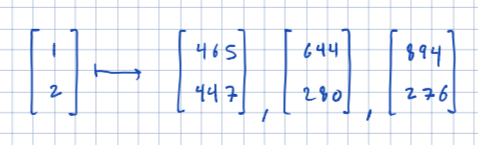
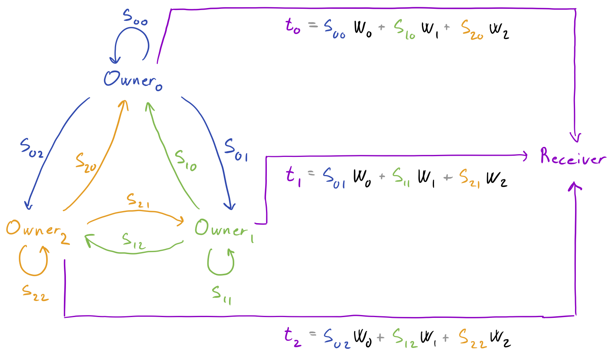

<link href="https://fonts.googleapis.com/css2?family=Indie+Flower&display=swap" rel="stylesheet">
<link href="/css/handwritten.css" rel="stylesheet">
<style>
img {
    margin-left: auto;
    margin-right: auto;
}

.intro-header .post-heading h1 {
    font-size: 54px;
}
</style>

<em><strong>TL;DR:</strong> In this series of blog posts we go through how modern cryptography can be used to perform secure aggregation for private analytics and federated learning. As we will see, the right approach depends on the concrete scenario, and in this first part we start with the simpler case consisting of a network of stable parties.

<!--
Federated learning has gained a lot of popularity in recent years as a way of keeping training data ...

What happens when you want to do secure multiparty computation but you're the only party that's really interested in investing resources in it?

As we will see, the main question we answer is, what happens when you want to do secure multiparty computation but you're the only party that's really interested in investing resources in it?

Secure multiparty computation (MPC) is an amazing technology when you need to ensure privacy in computations: you essentially have a bunch of parties that each have a data set they wish to keep private, yet using these techniques they can still evaluate a function on the joint data sets and only reveal the output.

In this blog post we'll step through a simple solution for federated learning we came up with a few years ago.

this came out at about the same time as Google's secure aggregation paper; where they were training neural networks by averaging gradients, we wanted to generate global prior distributions for recommendations (see paper for more use cases)

in this post i want to not only show how it works but also how we built it
-->

# Motivation

<em>(coming ...)</em>

<!--

https://ai.googleblog.com/2017/04/federated-learning-collaborative.html

https://eprint.iacr.org/2017/281

https://arxiv.org/abs/1902.01046

we had statistics in mind before thinking about DL

Fully Decentralized solution presented here

-->

## Federated Learning

## Analytics and statistics

## Secure aggregation

From the above use-cases we are going to focus on the problem of aggregating large vectors held by a set of users such that an intended recipient learns their weighted sum yet the individual vectors remain private. For our running example we are concretely going to assume three users.

```python
users = [
    User('user1'),
    User('user2'),
    User('user3'),
]

output_receiver = OutputReceiver()
```

<!--  -->

Note that the weighted sum inherently reveals *something* about the inputs, namely that which can be derived from it. For instance, by learning that a sum taking using equal weights is e.g. `150`, one also learns that *someone* had an input that was *at most* `150/3 == 50`. Mitigating this type of leakage requires additional techniques such as differential privacy.

# The Insecure Solution

No cryptography used. Single trusted aggregator.

# Distributing Trust

Introduce more aggregators and distribute trust between them.

Our starting point is a simple solution based on [additive secret sharing](/2017/06/04/secret-sharing-part1/#additive-sharing). Recall that in this scheme, a secret is split into a number of shares in such a way that if you have less than all shares then nothing is leaked about the secret, yet if you have all then the secret can be reconstructed. As seen below, this is achieved by letting all but one share be independently random values, and using the sum of these to blind the secret as the final share (essentially forming a [one-time pad](https://en.wikipedia.org/wiki/One-time_pad) encryption of the secret). To reconstruct you simply sum all shares together.

```python
def share(secret, number_of_shares):
    random_shares = [
        sample_randomness(secret.shape)
        for _ in range(number_of_shares - 1)
    ]
    missing_share = (secret - sum(random_shares)) % Q
    return [missing_share] + random_shares

def reconstruct(shares):
    secret = sum(shares) % Q
    return secret
```

For instance, secret `x0` may be shared into `[s00, s01, s02]`, where `s00` is the blinded secret, and `s01` and `s02` are randomly sampled. Concretely, if `x0` is the vector `[1, 2]` then we might share that into the following three vectors.


<div class="hw hw-grid" style="grid-template-columns: repeat(7, auto);">
<span class="mat c-blue"><span class="lbl">x<sub>0</sub></span><span class="br"><span>1</span><span>2</span></span></span>
<span class="arrow c-blue"><span class="maps"></span></span>
<span class="mat c-blue"><span class="lbl">s<sub>00</sub></span><span class="br"><span>465</span><span>447</span></span></span>
<span class="low">,</span>
<span class="mat c-blue"><span class="lbl">s<sub>01</sub></span><span class="br"><span>644</span><span>280</span></span></span>
<span class="low">,</span>
<span class="mat c-blue"><span class="lbl">s<sub>02</sub></span><span class="br"><span>894</span><span>276</span></span></span>
</div>
<!--  -->

We also take advantage of the fact that the scheme allows us to compute on secret values by computing on the shares, i.e. while they remain encrypted. In particular, that we can compute a weighted sum of secret values by computing a weighted sum over each corresponding set of shares.

```python
def weighted_sum(shares, weights):
    shares_as_matrix = np.stack(shares, axis=1)
    return np.dot(shares_as_matrix, weights) % Q
```

For instance, say we have shared three secrets `x0`, `x1`, and `x2`:

<div class="hw hw-grid" style="grid-template-columns: repeat(7, auto);">
<span class="mat c-blue"><span class="lbl">x<sub>0</sub></span><span class="br"><span>1</span><span>2</span></span></span>
<span class="arrow c-blue"><span class="maps"></span></span>
<span class="mat c-blue"><span class="lbl">s<sub>00</sub></span><span class="br"><span>465</span><span>447</span></span></span>
<span class="low">,</span>
<span class="mat c-blue"><span class="lbl">s<sub>01</sub></span><span class="br"><span>644</span><span>280</span></span></span>
<span class="low">,</span>
<span class="mat c-blue"><span class="lbl">s<sub>02</sub></span><span class="br"><span>894</span><span>276</span></span></span>
<span class="mat c-green"><span class="lbl">x<sub>1</sub></span><span class="br"><span>10</span><span>20</span></span></span>
<span class="arrow c-green"><span class="maps"></span></span>
<span class="mat c-green"><span class="lbl">s<sub>10</sub></span><span class="br"><span>314</span><span>679</span></span></span>
<span class="low">,</span>
<span class="mat c-green"><span class="lbl">s<sub>11</sub></span><span class="br"><span>943</span><span>883</span></span></span>
<span class="low">,</span>
<span class="mat c-green"><span class="lbl">s<sub>12</sub></span><span class="br"><span>755</span><span>460</span></span></span>
<span class="mat c-orange"><span class="lbl">x<sub>2</sub></span><span class="br"><span>100</span><span>200</span></span></span>
<span class="arrow c-orange"><span class="maps"></span></span>
<span class="mat c-orange"><span class="lbl">s<sub>20</sub></span><span class="br"><span>470</span><span>455</span></span></span>
<span class="low">,</span>
<span class="mat c-orange"><span class="lbl">s<sub>21</sub></span><span class="br"><span>997</span><span>496</span></span></span>
<span class="low">,</span>
<span class="mat c-orange"><span class="lbl">s<sub>22</sub></span><span class="br"><span>635</span><span>250</span></span></span>
</div>

By computing a weighted sum over each set of shares:

<div class="hw hw-grid" style="grid-template-columns: repeat(5, auto);">
<span class="mat c-blue"><span class="lbl">s<sub>00</sub></span><span class="br"><span>465</span><span>447</span></span></span>
<span class="low">,</span>
<span class="mat c-blue"><span class="lbl">s<sub>01</sub></span><span class="br"><span>644</span><span>280</span></span></span>
<span class="low">,</span>
<span class="mat c-blue"><span class="lbl">s<sub>02</sub></span><span class="br"><span>894</span><span>276</span></span></span>
<span class="mat c-green"><span class="lbl">s<sub>10</sub></span><span class="br"><span>314</span><span>679</span></span></span>
<span class="low">,</span>
<span class="mat c-green"><span class="lbl">s<sub>11</sub></span><span class="br"><span>943</span><span>883</span></span></span>
<span class="low">,</span>
<span class="mat c-green"><span class="lbl">s<sub>12</sub></span><span class="br"><span>755</span><span>460</span></span></span>
<span class="mat c-orange"><span class="lbl">s<sub>20</sub></span><span class="br"><span>470</span><span>455</span></span></span>
<span class="low">,</span>
<span class="mat c-orange"><span class="lbl">s<sub>21</sub></span><span class="br"><span>997</span><span>496</span></span></span>
<span class="low">,</span>
<span class="mat c-orange"><span class="lbl">s<sub>22</sub></span><span class="br"><span>635</span><span>250</span></span></span>
</div>
<div class="hw hw-grid" style="grid-template-columns: repeat(5, auto);">
<span class="mat c-grey"><span class="br" style="grid-template-columns: repeat(3, auto)"><span class="c-blue">465</span><span class="c-green">314</span><span class="c-orange">470</span><span class="c-blue">447</span><span class="c-green">679</span><span class="c-orange">455</span></span></span>
<span>·</span>
<span class="mat c-black"><span class="lbl">w</span><span class="br"><span>3</span><span>2</span><span>1</span></span></span>
<span class="arrow c-blue"><span class="maps"></span></span>
<span class="mat c-purple"><span class="lbl">t<sub>0</sub></span><span class="br"><span>491</span><span>151</span></span></span>
<span class="mat c-grey"><span class="br" style="grid-template-columns: repeat(3, auto)"><span class="c-blue">644</span><span class="c-green">943</span><span class="c-orange">997</span><span class="c-blue">280</span><span class="c-green">883</span><span class="c-orange">496</span></span></span>
<span>·</span>
<span class="mat c-black"><span class="lbl">w</span><span class="br"><span>3</span><span>2</span><span>1</span></span></span>
<span class="arrow c-green"><span class="maps"></span></span>
<span class="mat c-purple"><span class="lbl">t<sub>1</sub></span><span class="br"><span>811</span><span>99</span></span></span>
<span class="mat c-grey"><span class="br" style="grid-template-columns: repeat(3, auto)"><span class="c-blue">894</span><span class="c-green">755</span><span class="c-orange">635</span><span class="c-blue">276</span><span class="c-green">460</span><span class="c-orange">250</span></span></span>
<span>·</span>
<span class="mat c-black"><span class="lbl">w</span><span class="br"><span>3</span><span>2</span><span>1</span></span></span>
<span class="arrow c-orange"><span class="maps"></span></span>
<span class="mat c-purple"><span class="lbl">t<sub>2</sub></span><span class="br"><span>823</span><span>997</span></span></span>
</div>

we then end up with shares `t0`, `t1`, and `t2` of the weighted sum `(x0 * w0) + (x1 * w1) + (x2 * w2)`:

<div class="hw hw-grid" style="grid-template-columns: repeat(7, auto);">
<span class="mat c-purple"><span class="lbl">t<sub>0</sub></span><span class="br"><span>491</span><span>151</span></span></span>
<span>+</span>
<span class="mat c-purple"><span class="lbl">t<sub>1</sub></span><span class="br"><span>811</span><span>99</span></span></span>
<span>+</span>
<span class="mat c-purple"><span class="lbl">t<sub>2</sub></span><span class="br"><span>823</span><span>997</span></span></span>
<span class="arrow c-purple"><span class="maps"></span></span>
<span class="mat c-purple"><span class="lbl">y</span><span class="br"><span>123</span><span>246</span></span></span>
</div>


For simplicity we here assume three data owners, but the same approach works for any number of owners.

**TODO** figure with owners and x

In the first step, each data owner secret shares its input and sends a share to each of the other owners (including keeping one for itself).

<div class="hw hw-svg" style="max-width: 400px"><svg viewBox="0 0 660 780" role="img" aria-label="Three data owners in a triangle, each sending a value to every other owner"><defs><marker id="hw-ah-b-a" class="c-blue" viewBox="0 0 10 10" refX="8" refY="5" markerWidth="7" markerHeight="7" orient="auto-start-reverse" markerUnits="userSpaceOnUse" style="overflow:visible"><path d="M0 0 L9 5 L0 10" fill="none" stroke="currentColor" stroke-width="1.6" stroke-linecap="round" transform="scale(2.2) translate(-4.5 -2.5)"/></marker><marker id="hw-ah-g-a" class="c-green" viewBox="0 0 10 10" refX="8" refY="5" markerWidth="7" markerHeight="7" orient="auto-start-reverse" markerUnits="userSpaceOnUse" style="overflow:visible"><path d="M0 0 L9 5 L0 10" fill="none" stroke="currentColor" stroke-width="1.6" stroke-linecap="round" transform="scale(2.2) translate(-4.5 -2.5)"/></marker><marker id="hw-ah-o-a" class="c-orange" viewBox="0 0 10 10" refX="8" refY="5" markerWidth="7" markerHeight="7" orient="auto-start-reverse" markerUnits="userSpaceOnUse" style="overflow:visible"><path d="M0 0 L9 5 L0 10" fill="none" stroke="currentColor" stroke-width="1.6" stroke-linecap="round" transform="scale(2.2) translate(-4.5 -2.5)"/></marker><marker id="hw-ah-p-a" class="c-purple" viewBox="0 0 10 10" refX="8" refY="5" markerWidth="7" markerHeight="7" orient="auto-start-reverse" markerUnits="userSpaceOnUse" style="overflow:visible"><path d="M0 0 L9 5 L0 10" fill="none" stroke="currentColor" stroke-width="1.6" stroke-linecap="round" transform="scale(2.2) translate(-4.5 -2.5)"/></marker></defs><text class="c-blue" x="320" y="205" font-size="46" text-anchor="middle"><tspan>Owner</tspan><tspan dy="0.3em" font-size="0.62em">0</tspan></text><text class="c-green" x="545" y="580" font-size="46" text-anchor="middle"><tspan>Owner</tspan><tspan dy="0.3em" font-size="0.62em">1</tspan></text><text class="c-orange" x="100" y="580" font-size="46" text-anchor="middle"><tspan>Owner</tspan><tspan dy="0.3em" font-size="0.62em">2</tspan></text><path class="line c-blue" d="M215 250 Q115 350 70 525" marker-end="url(#hw-ah-b-a)"/><text class="c-blue" x="55" y="380" font-size="38" text-anchor="middle"><tspan>s</tspan><tspan dy="0.3em" font-size="0.62em">02</tspan></text><path class="line c-orange" d="M155 530 Q265 430 300 255" marker-end="url(#hw-ah-o-a)"/><text class="c-orange" x="215" y="420" font-size="38" text-anchor="middle"><tspan>s</tspan><tspan dy="0.3em" font-size="0.62em">20</tspan></text><path class="line c-green" d="M490 530 Q380 430 350 255" marker-end="url(#hw-ah-g-a)"/><text class="c-green" x="450" y="420" font-size="38" text-anchor="middle"><tspan>s</tspan><tspan dy="0.3em" font-size="0.62em">10</tspan></text><path class="line c-blue" d="M430 250 Q530 350 570 525" marker-end="url(#hw-ah-b-a)"/><text class="c-blue" x="585" y="380" font-size="38" text-anchor="middle"><tspan>s</tspan><tspan dy="0.3em" font-size="0.62em">01</tspan></text><path class="line c-orange" d="M215 560 Q330 505 445 550" marker-end="url(#hw-ah-o-a)"/><text class="c-orange" x="335" y="505" font-size="38" text-anchor="middle"><tspan>s</tspan><tspan dy="0.3em" font-size="0.62em">21</tspan></text><path class="line c-green" d="M450 610 Q330 665 215 615" marker-end="url(#hw-ah-g-a)"/><text class="c-green" x="335" y="680" font-size="38" text-anchor="middle"><tspan>s</tspan><tspan dy="0.3em" font-size="0.62em">12</tspan></text><path class="line c-blue" d="M345 145 C 375 60, 255 60, 290 140" marker-end="url(#hw-ah-b-a)"/><text class="c-blue" x="315" y="62" font-size="38" text-anchor="middle"><tspan>s</tspan><tspan dy="0.3em" font-size="0.62em">00</tspan></text><path class="line c-green" d="M560 620 C 595 700, 505 705, 525 630" marker-end="url(#hw-ah-g-a)"/><text class="c-green" x="550" y="760" font-size="38" text-anchor="middle"><tspan>s</tspan><tspan dy="0.3em" font-size="0.62em">11</tspan></text><path class="line c-orange" d="M115 620 C 150 700, 60 705, 80 630" marker-end="url(#hw-ah-o-a)"/><text class="c-orange" x="105" y="760" font-size="38" text-anchor="middle"><tspan>s</tspan><tspan dy="0.3em" font-size="0.62em">22</tspan></text></svg></div>

Once all shares have been distributed, i.e. every owner has a share from every other owner, they each compute a weighted sum. These sums are in fact shares of the output, which they send to the output receiver.

<div class="hw hw-route">
<span class="owner o0 c-blue">Owner<sub>0</sub></span>
<span class="leg o0"><span class="hw-eq"><span><span class="c-purple">t<sub>0</sub></span></span><span>=</span><span><span class="c-blue">s<sub>00</sub></span> <span class="c-black">w<sub>0</sub></span> + <span class="c-green">s<sub>10</sub></span> <span class="c-black">w<sub>1</sub></span> + <span class="c-orange">s<sub>20</sub></span> <span class="c-black">w<sub>2</sub></span></span></span><span class="maps c-purple"></span></span>
<span class="owner o1 c-green">Owner<sub>1</sub></span>
<span class="leg o1"><span class="hw-eq"><span><span class="c-purple">t<sub>1</sub></span></span><span>=</span><span><span class="c-blue">s<sub>01</sub></span> <span class="c-black">w<sub>0</sub></span> + <span class="c-green">s<sub>11</sub></span> <span class="c-black">w<sub>1</sub></span> + <span class="c-orange">s<sub>21</sub></span> <span class="c-black">w<sub>2</sub></span></span></span><span class="maps c-purple"></span></span>
<span class="owner o2 c-orange">Owner<sub>2</sub></span>
<span class="leg o2"><span class="hw-eq"><span><span class="c-purple">t<sub>2</sub></span></span><span>=</span><span><span class="c-blue">s<sub>02</sub></span> <span class="c-black">w<sub>0</sub></span> + <span class="c-green">s<sub>12</sub></span> <span class="c-black">w<sub>1</sub></span> + <span class="c-orange">s<sub>22</sub></span> <span class="c-black">w<sub>2</sub></span></span></span><span class="maps c-purple"></span></span>
<span class="recv c-purple">Receiver</span>
</div>

Finally, having received a share from every owner, the output receiver can reconstruct to learn the result.

**TODO** figure with y = t0 + t1 + t2

<!--  -->

In code the above steps are as follows:

```python
# step 1
for x, owner in zip(inputs, data_owners):
    owner.distribute_shares_of_input(x, data_owners)

# step 2
for owner in data_owners:
    owner.aggregate_and_send_share_of_output(weights, output_receiver)

# step 3
output = output_receiver.reconstruct_output()
```

where `data_owners` and `output_receiver` are instances of the following classes:

```python
def distribute_shares_of_input(user, x, aggregators):
    shares_of_input = share(x, len(aggregators))
    user.send('input_shares', {
        aggregator: share
        for aggregator, share in zip(aggregators, shares_of_input)
    })

def aggregate_and_send_share_of_output(aggregator, weights, output_receiver):
    shares_to_aggregate = aggregator.receive('input_shares')
    share_of_output = weighted_sum(shares_to_aggregate, weights)
    aggregator.send('output_shares', {
        output_receiver: share_of_output
    })

def reconstruct_output(output_receiver):
    shares_of_output = output_receiver.receive('output_shares')
    output = additive_reconstruct(shares_of_output)
    return output
```

The security of this approach follows directly from the secret sharing scheme: no owner has enough shares to reconstruct neither the inputs nor the output, and the output receiver only sees shares of the output. In fact, because we are using a scheme with a [privacy threshold](/2017/06/04/secret-sharing-part1/#comparing-schemes) of `n - 1`, this holds even if all players except one are colluding, meaning each data owner only has to trust itself.


## A concrete example

We can look at a concrete execution to better see how and why this works. Here, the inputs of the data owners are `[1, 2]`, `[10, 20]`, and `[100, 200]` respectively, and the weights are `[3, 2, 1]`. This means that our expected result is `[1*3 + 10*2 + 100*1, 2*3 + 20*2 + 200*1] == [123, 246]`.

In the first step, each data owner shares its input vector into three random vectors, resulting in an imaginary `(3, 3, 2)` tensor `s`. For instance, sharing `x0` results in `s00`, `s01`, and `s02` where `s00 + s01 + s02 == x0` (modulus `Q`).

<div class="hw hw-grid" style="grid-template-columns: repeat(7, auto);">
<span class="mat c-blue"><span class="lbl">x<sub>0</sub></span><span class="br"><span>1</span><span>2</span></span></span>
<span class="arrow c-blue"><span class="maps"></span></span>
<span class="mat c-blue"><span class="lbl">s<sub>00</sub></span><span class="br"><span>465</span><span>447</span></span></span>
<span class="low">,</span>
<span class="mat c-blue"><span class="lbl">s<sub>01</sub></span><span class="br"><span>644</span><span>280</span></span></span>
<span class="low">,</span>
<span class="mat c-blue"><span class="lbl">s<sub>02</sub></span><span class="br"><span>894</span><span>276</span></span></span>
<span class="mat c-green"><span class="lbl">x<sub>1</sub></span><span class="br"><span>10</span><span>20</span></span></span>
<span class="arrow c-green"><span class="maps"></span></span>
<span class="mat c-green"><span class="lbl">s<sub>10</sub></span><span class="br"><span>314</span><span>679</span></span></span>
<span class="low">,</span>
<span class="mat c-green"><span class="lbl">s<sub>11</sub></span><span class="br"><span>943</span><span>883</span></span></span>
<span class="low">,</span>
<span class="mat c-green"><span class="lbl">s<sub>12</sub></span><span class="br"><span>755</span><span>460</span></span></span>
<span class="mat c-orange"><span class="lbl">x<sub>2</sub></span><span class="br"><span>100</span><span>200</span></span></span>
<span class="arrow c-orange"><span class="maps"></span></span>
<span class="mat c-orange"><span class="lbl">s<sub>20</sub></span><span class="br"><span>470</span><span>455</span></span></span>
<span class="low">,</span>
<span class="mat c-orange"><span class="lbl">s<sub>21</sub></span><span class="br"><span>997</span><span>496</span></span></span>
<span class="low">,</span>
<span class="mat c-orange"><span class="lbl">s<sub>22</sub></span><span class="br"><span>635</span><span>250</span></span></span>
</div>

In the next step, each owner then computes a weighted sum across one of the three columns, resulting in three new vectors `t0`, `t1`, and `t2`.

<div class="hw hw-grid" style="grid-template-columns: repeat(5, auto);">
<span class="mat c-blue"><span class="lbl">s<sub>00</sub></span><span class="br"><span>465</span><span>447</span></span></span>
<span class="low">,</span>
<span class="mat c-blue"><span class="lbl">s<sub>01</sub></span><span class="br"><span>644</span><span>280</span></span></span>
<span class="low">,</span>
<span class="mat c-blue"><span class="lbl">s<sub>02</sub></span><span class="br"><span>894</span><span>276</span></span></span>
<span class="mat c-green"><span class="lbl">s<sub>10</sub></span><span class="br"><span>314</span><span>679</span></span></span>
<span class="low">,</span>
<span class="mat c-green"><span class="lbl">s<sub>11</sub></span><span class="br"><span>943</span><span>883</span></span></span>
<span class="low">,</span>
<span class="mat c-green"><span class="lbl">s<sub>12</sub></span><span class="br"><span>755</span><span>460</span></span></span>
<span class="mat c-orange"><span class="lbl">s<sub>20</sub></span><span class="br"><span>470</span><span>455</span></span></span>
<span class="low">,</span>
<span class="mat c-orange"><span class="lbl">s<sub>21</sub></span><span class="br"><span>997</span><span>496</span></span></span>
<span class="low">,</span>
<span class="mat c-orange"><span class="lbl">s<sub>22</sub></span><span class="br"><span>635</span><span>250</span></span></span>
</div>
<div class="hw hw-grid" style="grid-template-columns: repeat(5, auto);">
<span class="mat c-grey"><span class="br" style="grid-template-columns: repeat(3, auto)"><span class="c-blue">465</span><span class="c-green">314</span><span class="c-orange">470</span><span class="c-blue">447</span><span class="c-green">679</span><span class="c-orange">455</span></span></span>
<span>·</span>
<span class="mat c-black"><span class="lbl">w</span><span class="br"><span>3</span><span>2</span><span>1</span></span></span>
<span class="arrow c-blue"><span class="maps"></span></span>
<span class="mat c-purple"><span class="lbl">t<sub>0</sub></span><span class="br"><span>491</span><span>151</span></span></span>
<span class="mat c-grey"><span class="br" style="grid-template-columns: repeat(3, auto)"><span class="c-blue">644</span><span class="c-green">943</span><span class="c-orange">997</span><span class="c-blue">280</span><span class="c-green">883</span><span class="c-orange">496</span></span></span>
<span>·</span>
<span class="mat c-black"><span class="lbl">w</span><span class="br"><span>3</span><span>2</span><span>1</span></span></span>
<span class="arrow c-green"><span class="maps"></span></span>
<span class="mat c-purple"><span class="lbl">t<sub>1</sub></span><span class="br"><span>811</span><span>99</span></span></span>
<span class="mat c-grey"><span class="br" style="grid-template-columns: repeat(3, auto)"><span class="c-blue">894</span><span class="c-green">755</span><span class="c-orange">635</span><span class="c-blue">276</span><span class="c-green">460</span><span class="c-orange">250</span></span></span>
<span>·</span>
<span class="mat c-black"><span class="lbl">w</span><span class="br"><span>3</span><span>2</span><span>1</span></span></span>
<span class="arrow c-orange"><span class="maps"></span></span>
<span class="mat c-purple"><span class="lbl">t<sub>2</sub></span><span class="br"><span>823</span><span>997</span></span></span>
</div>

In the final step these three vectors are added together by the output receiver.

<div class="hw hw-grid" style="grid-template-columns: repeat(7, auto);">
<span class="mat c-purple"><span class="lbl">t<sub>0</sub></span><span class="br"><span>491</span><span>151</span></span></span>
<span>+</span>
<span class="mat c-purple"><span class="lbl">t<sub>1</sub></span><span class="br"><span>811</span><span>99</span></span></span>
<span>+</span>
<span class="mat c-purple"><span class="lbl">t<sub>2</sub></span><span class="br"><span>823</span><span>997</span></span></span>
<span class="arrow c-purple"><span class="maps"></span></span>
<span class="mat c-purple"><span class="lbl">y</span><span class="br"><span>123</span><span>246</span></span></span>
</div>

While this protocol already offers good performance, it can also be significantly optimized if we are willing to make some assumptions about the scenario in which it is used and the reliability of the parties involved. In particular, in the following sections we shall see how communication can be reduced significantly if it is repeatedly executed by the same parties.


this is typically a good solution when the aggregate happens between a few data owners connected on reilable high-speed networks

gives high security since each data owner only has to trust themselves

it unfortunately also has a serious problem if we were to use it across e.g. the internet, where users are somewhat sporadic. In particular, the distribution of shares represents a significant synchronization point between all users, where even a single one of them can bring the protocol to a halt by failing to send their shares.

# The Basic Idea

Say our goal is to compute `y` as defined by following expression, i.e. as the weighted sum of vectors `x0`, `x1`, `x2` using weights `3`, `2`, `1` respectively:

<div class="hw hw-grid" style="grid-template-columns: repeat(9, auto);">
<span class="mat c-blue"><span class="lbl">x<sub>0</sub></span><span class="br"><span>1</span><span>2</span></span></span>
<span class="c-black">· 3</span>
<span>+</span>
<span class="mat c-green"><span class="lbl">x<sub>1</sub></span><span class="br"><span>10</span><span>20</span></span></span>
<span class="c-black">· 2</span>
<span>+</span>
<span class="mat c-orange"><span class="lbl">x<sub>2</sub></span><span class="br"><span>100</span><span>200</span></span></span>
<span class="c-black">· 1</span>
<span style="display:flex;align-items:center;gap:0.5em">=&nbsp;<span class="mat c-purple"><span class="lbl">y</span><span class="br"><span>123</span><span>246</span></span></span></span>
</div>

This can be done  by the following

In the next section it will become obvious why one would do so, you could replace 

<div class="hw hw-grid" style="grid-template-columns: repeat(7, auto);row-gap: 1em;">
<span class="mat c-blue"><span class="lbl">x<sub>0</sub></span><span class="br"><span>1</span><span>2</span></span></span>
<span>=</span>
<span class="mat c-blue"><span class="lbl">s<sub>00</sub></span><span class="br"><span>465</span><span>447</span></span></span>
<span>+</span>
<span class="mat c-blue"><span class="lbl">s<sub>01</sub></span><span class="br"><span>644</span><span>280</span></span></span>
<span>+</span>
<span class="mat c-blue"><span class="lbl">s<sub>02</sub></span><span class="br"><span>894</span><span>276</span></span></span>
<span class="mat c-green"><span class="lbl">x<sub>1</sub></span><span class="br"><span>10</span><span>20</span></span></span>
<span>=</span>
<span class="mat c-green"><span class="lbl">s<sub>10</sub></span><span class="br"><span>314</span><span>679</span></span></span>
<span>+</span>
<span class="mat c-green"><span class="lbl">s<sub>11</sub></span><span class="br"><span>943</span><span>883</span></span></span>
<span>+</span>
<span class="mat c-green"><span class="lbl">s<sub>12</sub></span><span class="br"><span>755</span><span>460</span></span></span>
<span class="mat c-orange"><span class="lbl">x<sub>2</sub></span><span class="br"><span>100</span><span>200</span></span></span>
<span>=</span>
<span class="mat c-orange"><span class="lbl">s<sub>20</sub></span><span class="br"><span>470</span><span>455</span></span></span>
<span>+</span>
<span class="mat c-orange"><span class="lbl">s<sub>21</sub></span><span class="br"><span>997</span><span>496</span></span></span>
<span>+</span>
<span class="mat c-orange"><span class="lbl">s<sub>22</sub></span><span class="br"><span>635</span><span>250</span></span></span>
</div>

cd

<div class="hw hw-grid" style="grid-template-columns: repeat(3, auto);">
<span class="paren" style="grid-template-columns: repeat(5, auto)"><span class="mat c-blue"><span class="lbl">s<sub>00</sub></span><span class="br"><span>465</span><span>447</span></span></span><span>+</span><span class="mat c-blue"><span class="lbl">s<sub>01</sub></span><span class="br"><span>644</span><span>280</span></span></span><span>+</span><span class="mat c-blue"><span class="lbl">s<sub>02</sub></span><span class="br"><span>894</span><span>276</span></span></span></span>
<span class="c-black">· 3</span>
<span>+</span>
<span></span>
<span class="paren" style="grid-template-columns: repeat(5, auto)"><span class="mat c-green"><span class="lbl">s<sub>10</sub></span><span class="br"><span>314</span><span>679</span></span></span><span>+</span><span class="mat c-green"><span class="lbl">s<sub>11</sub></span><span class="br"><span>943</span><span>883</span></span></span><span>+</span><span class="mat c-green"><span class="lbl">s<sub>12</sub></span><span class="br"><span>755</span><span>460</span></span></span></span>
<span class="c-black">· 2</span>
<span>+</span>
<span></span>
<span class="paren" style="grid-template-columns: repeat(5, auto)"><span class="mat c-orange"><span class="lbl">s<sub>20</sub></span><span class="br"><span>470</span><span>455</span></span></span><span>+</span><span class="mat c-orange"><span class="lbl">s<sub>21</sub></span><span class="br"><span>997</span><span>496</span></span></span><span>+</span><span class="mat c-orange"><span class="lbl">s<sub>22</sub></span><span class="br"><span>635</span><span>250</span></span></span></span>
<span class="c-black">· 1</span>
<span style="grid-column: 3; grid-row: 1 / span 5; display: flex; align-items: center; gap: 0.5em; margin-left: 0.6em">=&nbsp;<span class="mat c-purple"><span class="lbl">y</span><span class="br"><span>123</span><span>246</span></span></span></span>
</div>

cdscd

<div class="hw hw-grid" style="grid-template-columns: repeat(6, auto);">
<span class="paren" style="grid-template-columns: repeat(2, auto)"><span class="mat c-blue"><span class="lbl">s<sub>00</sub></span><span class="br"><span>465</span><span>447</span></span></span><span class="c-black">· 3</span><span>+</span><span></span><span class="mat c-green"><span class="lbl">s<sub>10</sub></span><span class="br"><span>314</span><span>679</span></span></span><span class="c-black">· 2</span><span>+</span><span></span><span class="mat c-orange"><span class="lbl">s<sub>20</sub></span><span class="br"><span>470</span><span>455</span></span></span><span class="c-black">· 1</span></span>
<span>+</span>
<span class="paren" style="grid-template-columns: repeat(2, auto)"><span class="mat c-blue"><span class="lbl">s<sub>01</sub></span><span class="br"><span>644</span><span>280</span></span></span><span class="c-black">· 3</span><span>+</span><span></span><span class="mat c-green"><span class="lbl">s<sub>11</sub></span><span class="br"><span>943</span><span>883</span></span></span><span class="c-black">· 2</span><span>+</span><span></span><span class="mat c-orange"><span class="lbl">s<sub>21</sub></span><span class="br"><span>997</span><span>496</span></span></span><span class="c-black">· 1</span></span>
<span>+</span>
<span class="paren" style="grid-template-columns: repeat(2, auto)"><span class="mat c-blue"><span class="lbl">s<sub>02</sub></span><span class="br"><span>894</span><span>276</span></span></span><span class="c-black">· 3</span><span>+</span><span></span><span class="mat c-green"><span class="lbl">s<sub>12</sub></span><span class="br"><span>755</span><span>460</span></span></span><span class="c-black">· 2</span><span>+</span><span></span><span class="mat c-orange"><span class="lbl">s<sub>22</sub></span><span class="br"><span>635</span><span>250</span></span></span><span class="c-black">· 1</span></span>
<span style="display:flex;align-items:center;gap:0.5em;margin-left:0.3em">=&nbsp;<span class="mat c-purple"><span class="lbl">y</span><span class="br"><span>123</span><span>246</span></span></span></span>
</div>

cdscds

<div class="hw hw-grid" style="grid-template-columns: repeat(3, auto);column-gap: 1.5em;">
<span class="paren" style="grid-template-columns: repeat(2, auto)"><span class="mat c-blue"><span class="lbl">s<sub>00</sub></span><span class="br"><span>465</span><span>447</span></span></span><span class="c-black">· 3</span><span>+</span><span></span><span class="mat c-green"><span class="lbl">s<sub>10</sub></span><span class="br"><span>314</span><span>679</span></span></span><span class="c-black">· 2</span><span>+</span><span></span><span class="mat c-orange"><span class="lbl">s<sub>20</sub></span><span class="br"><span>470</span><span>455</span></span></span><span class="c-black">· 1</span></span>
<span class="paren" style="grid-template-columns: repeat(2, auto)"><span class="mat c-blue"><span class="lbl">s<sub>01</sub></span><span class="br"><span>644</span><span>280</span></span></span><span class="c-black">· 3</span><span>+</span><span></span><span class="mat c-green"><span class="lbl">s<sub>11</sub></span><span class="br"><span>943</span><span>883</span></span></span><span class="c-black">· 2</span><span>+</span><span></span><span class="mat c-orange"><span class="lbl">s<sub>21</sub></span><span class="br"><span>997</span><span>496</span></span></span><span class="c-black">· 1</span></span>
<span class="paren" style="grid-template-columns: repeat(2, auto)"><span class="mat c-blue"><span class="lbl">s<sub>02</sub></span><span class="br"><span>894</span><span>276</span></span></span><span class="c-black">· 3</span><span>+</span><span></span><span class="mat c-green"><span class="lbl">s<sub>12</sub></span><span class="br"><span>755</span><span>460</span></span></span><span class="c-black">· 2</span><span>+</span><span></span><span class="mat c-orange"><span class="lbl">s<sub>22</sub></span><span class="br"><span>635</span><span>250</span></span></span><span class="c-black">· 1</span></span>
<span class="veq">=</span>
<span class="veq">=</span>
<span class="veq">=</span>
<span class="mat c-purple"><span class="lbl">t<sub>0</sub></span><span class="br"><span>491</span><span>151</span></span></span>
<span class="mat c-purple"><span class="lbl">t<sub>1</sub></span><span class="br"><span>811</span><span>99</span></span></span>
<span class="mat c-purple"><span class="lbl">t<sub>2</sub></span><span class="br"><span>823</span><span>997</span></span></span>
</div>

cdscds

<div class="hw hw-grid" style="grid-template-columns: repeat(7, auto);">
<span class="mat c-purple"><span class="lbl">t<sub>0</sub></span><span class="br"><span>491</span><span>151</span></span></span>
<span>+</span>
<span class="mat c-purple"><span class="lbl">t<sub>1</sub></span><span class="br"><span>811</span><span>99</span></span></span>
<span>+</span>
<span class="mat c-purple"><span class="lbl">t<sub>2</sub></span><span class="br"><span>823</span><span>997</span></span></span>
<span>=</span>
<span class="mat c-purple"><span class="lbl">y</span><span class="br"><span>123</span><span>246</span></span></span>
</div>


# Optimizing For Server Setting

## Zero Masking

```python
def additive_share(secret, number_of_shares, index_of_masked_secret=0):
    shares = [
        sample_randomness(secret.shape)
        for _ in range(number_of_shares - 1)
    ]

    masked_secret = (secret - sum(shares)) % Q

    return shares[:index_of_masked_secret] + \
           [masked_secret] + \
           shares[index_of_masked_secret:]
```

<div class="hw hw-svg" style="max-width: 400px"><svg viewBox="0 0 660 780" role="img" aria-label="Three data owners in a triangle, each sending a value to every other owner"><defs><marker id="hw-ah-b-b" class="c-blue" viewBox="0 0 10 10" refX="8" refY="5" markerWidth="7" markerHeight="7" orient="auto-start-reverse" markerUnits="userSpaceOnUse" style="overflow:visible"><path d="M0 0 L9 5 L0 10" fill="none" stroke="currentColor" stroke-width="1.6" stroke-linecap="round" transform="scale(2.2) translate(-4.5 -2.5)"/></marker><marker id="hw-ah-g-b" class="c-green" viewBox="0 0 10 10" refX="8" refY="5" markerWidth="7" markerHeight="7" orient="auto-start-reverse" markerUnits="userSpaceOnUse" style="overflow:visible"><path d="M0 0 L9 5 L0 10" fill="none" stroke="currentColor" stroke-width="1.6" stroke-linecap="round" transform="scale(2.2) translate(-4.5 -2.5)"/></marker><marker id="hw-ah-o-b" class="c-orange" viewBox="0 0 10 10" refX="8" refY="5" markerWidth="7" markerHeight="7" orient="auto-start-reverse" markerUnits="userSpaceOnUse" style="overflow:visible"><path d="M0 0 L9 5 L0 10" fill="none" stroke="currentColor" stroke-width="1.6" stroke-linecap="round" transform="scale(2.2) translate(-4.5 -2.5)"/></marker><marker id="hw-ah-p-b" class="c-purple" viewBox="0 0 10 10" refX="8" refY="5" markerWidth="7" markerHeight="7" orient="auto-start-reverse" markerUnits="userSpaceOnUse" style="overflow:visible"><path d="M0 0 L9 5 L0 10" fill="none" stroke="currentColor" stroke-width="1.6" stroke-linecap="round" transform="scale(2.2) translate(-4.5 -2.5)"/></marker></defs><text class="c-blue" x="320" y="205" font-size="46" text-anchor="middle"><tspan>Owner</tspan><tspan dy="0.3em" font-size="0.62em">0</tspan></text><text class="c-green" x="545" y="580" font-size="46" text-anchor="middle"><tspan>Owner</tspan><tspan dy="0.3em" font-size="0.62em">1</tspan></text><text class="c-orange" x="100" y="580" font-size="46" text-anchor="middle"><tspan>Owner</tspan><tspan dy="0.3em" font-size="0.62em">2</tspan></text><path class="line c-blue" d="M215 250 Q115 350 70 525" marker-end="url(#hw-ah-b-b)"/><text class="c-blue" x="55" y="380" font-size="38" text-anchor="middle"><tspan>s</tspan><tspan dy="0.3em" font-size="0.62em">02</tspan></text><path class="line c-orange" d="M155 530 Q265 430 300 255" marker-end="url(#hw-ah-o-b)"/><text class="c-orange" x="215" y="420" font-size="38" text-anchor="middle"><tspan>s</tspan><tspan dy="0.3em" font-size="0.62em">20</tspan></text><path class="line c-green" d="M490 530 Q380 430 350 255" marker-end="url(#hw-ah-g-b)"/><text class="c-green" x="450" y="420" font-size="38" text-anchor="middle"><tspan>s</tspan><tspan dy="0.3em" font-size="0.62em">10</tspan></text><path class="line c-blue" d="M430 250 Q530 350 570 525" marker-end="url(#hw-ah-b-b)"/><text class="c-blue" x="585" y="380" font-size="38" text-anchor="middle"><tspan>s</tspan><tspan dy="0.3em" font-size="0.62em">01</tspan></text><path class="line c-orange" d="M215 560 Q330 505 445 550" marker-end="url(#hw-ah-o-b)"/><text class="c-orange" x="335" y="505" font-size="38" text-anchor="middle"><tspan>s</tspan><tspan dy="0.3em" font-size="0.62em">21</tspan></text><path class="line c-green" d="M450 610 Q330 665 215 615" marker-end="url(#hw-ah-g-b)"/><text class="c-green" x="335" y="680" font-size="38" text-anchor="middle"><tspan>s</tspan><tspan dy="0.3em" font-size="0.62em">12</tspan></text><path class="line c-blue" d="M345 145 C 375 60, 255 60, 290 140" marker-end="url(#hw-ah-b-b)"/><text class="c-blue" x="315" y="62" font-size="38" text-anchor="middle"><tspan>s</tspan><tspan dy="0.3em" font-size="0.62em">00</tspan></text><path class="line c-green" d="M560 620 C 595 700, 505 705, 525 630" marker-end="url(#hw-ah-g-b)"/><text class="c-green" x="550" y="760" font-size="38" text-anchor="middle"><tspan>s</tspan><tspan dy="0.3em" font-size="0.62em">11</tspan></text><path class="line c-orange" d="M115 620 C 150 700, 60 705, 80 630" marker-end="url(#hw-ah-o-b)"/><text class="c-orange" x="105" y="760" font-size="38" text-anchor="middle"><tspan>s</tspan><tspan dy="0.3em" font-size="0.62em">22</tspan></text></svg></div>
<div class="hw hw-route">
<span class="owner o0 c-blue">Owner<sub>0</sub></span>
<span class="leg o0"><span class="hw-eq"><span><span class="c-purple">t<sub>0</sub></span></span><span>=</span><span><span class="c-blue">s<sub>00</sub></span> <span class="c-black">w<sub>0</sub></span> + <span class="c-green">s<sub>10</sub></span> <span class="c-black">w<sub>1</sub></span> + <span class="c-orange">s<sub>20</sub></span> <span class="c-black">w<sub>2</sub></span></span><span></span><span class="minor">=</span><span class="minor">(x<sub>0</sub> - s<sub>01</sub> - s<sub>02</sub>) w<sub>0</sub> + s<sub>10</sub> w<sub>1</sub> + s<sub>20</sub> w<sub>2</sub></span><span></span><span class="minor">=</span><span class="minor">x<sub>0</sub> w<sub>0</sub> + (0 - s<sub>01</sub> - s<sub>02</sub>) w<sub>0</sub> + s<sub>10</sub> w<sub>1</sub> + s<sub>20</sub> w<sub>2</sub></span><span></span><span>=</span><span><span class="c-blue">x<sub>0</sub></span> <span class="c-black">w<sub>0</sub></span> + <span class="c-blue">m<sub>0</sub></span></span></span><span class="maps c-purple"></span></span>
<span class="owner o1 c-green">Owner<sub>1</sub></span>
<span class="leg o1"><span class="hw-eq"><span><span class="c-purple">t<sub>1</sub></span></span><span>=</span><span><span class="c-blue">s<sub>01</sub></span> <span class="c-black">w<sub>0</sub></span> + <span class="c-green">s<sub>11</sub></span> <span class="c-black">w<sub>1</sub></span> + <span class="c-orange">s<sub>21</sub></span> <span class="c-black">w<sub>2</sub></span></span><span></span><span class="minor">=</span><span class="minor">s<sub>01</sub> w<sub>0</sub> + (x<sub>1</sub> - s<sub>10</sub> - s<sub>12</sub>) w<sub>1</sub> + s<sub>21</sub> w<sub>2</sub></span><span></span><span class="minor">=</span><span class="minor">x<sub>1</sub> w<sub>1</sub> + s<sub>01</sub> w<sub>0</sub> + (0 - s<sub>10</sub> - s<sub>12</sub>) w<sub>1</sub> + s<sub>21</sub> w<sub>2</sub></span><span></span><span>=</span><span><span class="c-green">x<sub>1</sub></span> <span class="c-black">w<sub>1</sub></span> + <span class="c-green">m<sub>1</sub></span></span></span><span class="maps c-purple"></span></span>
<span class="owner o2 c-orange">Owner<sub>2</sub></span>
<span class="leg o2"><span class="hw-eq"><span><span class="c-purple">t<sub>2</sub></span></span><span>=</span><span><span class="c-blue">s<sub>02</sub></span> <span class="c-black">w<sub>0</sub></span> + <span class="c-green">s<sub>12</sub></span> <span class="c-black">w<sub>1</sub></span> + <span class="c-orange">s<sub>22</sub></span> <span class="c-black">w<sub>2</sub></span></span><span></span><span class="minor">=</span><span class="minor">s<sub>02</sub> w<sub>0</sub> + s<sub>12</sub> w<sub>1</sub> + (x<sub>2</sub> - s<sub>20</sub> - s<sub>21</sub>) w<sub>2</sub></span><span></span><span class="minor">=</span><span class="minor">x<sub>2</sub> w<sub>2</sub> + s<sub>02</sub> w<sub>0</sub> + s<sub>12</sub> w<sub>1</sub> + (0 - s<sub>20</sub> - s<sub>21</sub>) w<sub>2</sub></span><span></span><span>=</span><span><span class="c-orange">x<sub>2</sub></span> <span class="c-black">w<sub>2</sub></span> + <span class="c-orange">m<sub>2</sub></span></span></span><span class="maps c-purple"></span></span>
<span class="recv c-purple">Receiver</span>
</div>

```python
class DataOwner(Player):

    def distribute_shares_of_zero(self, input_shape, players):
        shares_of_zero = additive_share(
            secret=np.zeros(shape=input_shape, dtype=int),
            number_of_shared=len(players),
        )

        self.send('zero_shares', {
            player: share
            for player, share in zip(players, shares_of_zero)
        })

    def combine_shares_of_zero_and_send_masked_input(self, x, w, output_receiver):
        shares_to_combine = self.receive('zero_shares')
        share_of_zero = additive_sum(shares_to_combine)

        mask = share_of_zero
        x_masked = ((x * w) + mask) % Q

        self.send('output_shares', {
            output_receiver: x_masked
        })
```

## Pre-computing masks

```python
class DataOwner(Player):

    pregenerated_masks = []

    #
    # for offline phase
    #

    def distribute_shares_of_zero(self, input_shape, players):
        # (unchanged ...)

    def combine_shares_of_zero(self):
        shares_to_combine = self.receive('zero_shares')
        share_of_zero = additive_sum(shares_to_combine)

        mask = share_of_zero
        self.pregenerated_masks.append(mask)

    #
    # for online phase
    #

    def next_mask(self):
        return self.pregenerated_masks.pop(0)

    def send_masked_input(self, x, w, output_receiver):
        mask = self.next_mask()
        x_masked = ((x * w) + mask) % Q

        self.send('output_shares', {
            output_receiver: x_masked
        })
```

zero-sharing

To some extend this is the basis of Google's approach, where thet pick a subsample of data owners and add recovery mechanism

https://eprint.iacr.org/2017/281
Google’s Approach: https://acmccs.github.io/papers/p1175-bonawitzA.pdf

Correlated randomness, Google’s approach, and sensor networks

Fully decentralized can be broken into offline and online phase, where shares of zero are first generated by the users. This is essentially the basis of the Google protocol. One problem is if some users drop out between the two phases, and the Google protocol extends the basic idea to mitigate that issue. From an operational perspective they also keep the iterations very short, and only aggregate when phones are most stable (plugged and on wifi).

# Seeding

One rule of thumb in secure computation is to never sample and send large random values, but to sample and send a random seed instead. Since seeds are typically much smaller than the random values they are expanded into, this can potentially save a significant amount on communication cost at the expense of a bit of cheap computation on both the sender and the receiver (i.e. the usual [space-time tradeoff](https://en.wikipedia.org/wiki/Space%E2%80%93time_tradeoff)). This applies very nicely to our use case since all shares except one are just random values that can hence be replaced with seeds.

Before adapting our protocol to take advantage of seeds, we first need to address one small caveat; namely, that the expanded values are now technically only [pseudo-random](https://en.wikipedia.org/wiki/Pseudorandomness) with the risk of having an impact on the security of the protocol. However, at long as we make sure to expand the seeds using a [pseudo-random generator](https://en.wikipedia.org/wiki/Pseudorandom_generator) (PRG) that is [cryptographically strong](https://en.wikipedia.org/wiki/Cryptographically_secure_pseudorandom_number_generator) then this is not an issue for all practical purposes. In fact, it is likely to be *exactly* [how the operation system sample random values](https://en.wikipedia.org/wiki//dev/random) for you behind the scenes anyway.

```python
SEED_BITLENGTH = 80
S = 2**SEED_BITLENGTH

class Seed:
    def __init__(self, value, shape):
        self.value = value
        self.shape = shape

def sample_seed(shape):
    value = secrets.randbelow(S)
    return Seed(value, shape)

def expand_seed(seed):
    # TODO replace with secure expansion
    size = np.prod(seed.shape)
    random.seed(seed.value)
    randomness = [random.randrange(Q) for _ in range(size)]
    return np.array(randomness).reshape(seed.shape)

def expand_seeds_as_needed(values):
    expanded = [
        expand_seed(value) if isinstance(value, Seed) else value
        for value in values
    ]
    return expanded

def additive_share_with_seeds(secret, number_of_shares, index_of_masked_secret=0):
    shares = [
        sample_seed(secret.shape)
        for _ in range(number_of_shares - 1)
    ]
    masked_secret = (secret - sum(expand_seeds_as_needed(shares))) % Q
    return shares[:index_of_masked_secret] + \
           [masked_secret] + \
           shares[index_of_masked_secret:]
```

 More concretely, when the zero masks are being generated,  that each data owner keeps for itself ...


```python
class DataOwner(Player):

    pregenerated_masks = []

    #
    # offline phase
    #

    def distribute_shares_of_zero(self, input_shape, players):
        shares_of_zero = additive_share_with_seeds(
            secret=np.zeros(shape=input_shape, dtype=int),
            number_of_shares=len(players),
            index_of_masked_secret=index_in_list(self, players),
        )

        self.send('zero_shares', {
            player: share
            for player, share in zip(players, shares_of_zero)
        })

    def combine_shares_of_zero(self):
        shares_to_combine = self.receive('zero_shares')
        shares_to_combine = expand_seeds_as_needed(shares_to_combine)
        share_of_zero = additive_sum(shares_to_combine)

        mask = share_of_zero
        self.pregenerated_masks.append(mask)

    #
    # online phase
    #

    def next_mask(self):
        # (unchanged ...)

    def send_masked_input(self, x, w, output_receiver):
        # (unchanged ...)
```

This is a significant improvement for applications dealing with very large vectors, as we have brought the overhead of secure aggregation close to that of (insecure) aggregation: the only additional communication is for the seeds, so if the vectors are large then this become negligible. 

Moreover, if is it reasonable in the specific application to make the assumption that the same set of data owners will repeatedly make many aggregations, then the fact that we can pre-generate masks puts us in an even better situation. However, in that case we can actually do even better still.

## Keyed seeding

Above we were expanding a small random seed into a much larger value that from all practical purposes looked entirely random. However, we still had to rely on communication a small amount of random bits for every single mask. However, another cryptographic primitive called [pseudorandom functions](https://en.wikipedia.org/wiki/Pseudorandom_function_family) (PRF) allows us to essentially re-use these random bits for many masks, giving an advantage in the cases where the same set of data owners are in repeated need of masks. ChaCha20 is one such function, yet for the purpose of this blog post we continue to ...

The overall flow in the protocol looks the same, yet now the exchange between the owners for mask generation is replaced by a much rarer *key setup*. This process simply sees each owner sampling and distributing fresh keys, which are stored for future use. In particular, by giving these keys to a PRF together with an iteration number `i`, fresh masks can be generated and used for masks: `e(k, i)`. 

<div class="hw hw-svg" style="max-width: 400px"><svg viewBox="0 140 660 580" role="img" aria-label="Three data owners in a triangle, each sharing a key with every other owner"><defs><marker id="hw-ah-b-c" class="c-blue" viewBox="0 0 10 10" refX="8" refY="5" markerWidth="7" markerHeight="7" orient="auto-start-reverse" markerUnits="userSpaceOnUse" style="overflow:visible"><path d="M0 0 L9 5 L0 10" fill="none" stroke="currentColor" stroke-width="1.6" stroke-linecap="round" transform="scale(2.2) translate(-4.5 -2.5)"/></marker><marker id="hw-ah-g-c" class="c-green" viewBox="0 0 10 10" refX="8" refY="5" markerWidth="7" markerHeight="7" orient="auto-start-reverse" markerUnits="userSpaceOnUse" style="overflow:visible"><path d="M0 0 L9 5 L0 10" fill="none" stroke="currentColor" stroke-width="1.6" stroke-linecap="round" transform="scale(2.2) translate(-4.5 -2.5)"/></marker><marker id="hw-ah-o-c" class="c-orange" viewBox="0 0 10 10" refX="8" refY="5" markerWidth="7" markerHeight="7" orient="auto-start-reverse" markerUnits="userSpaceOnUse" style="overflow:visible"><path d="M0 0 L9 5 L0 10" fill="none" stroke="currentColor" stroke-width="1.6" stroke-linecap="round" transform="scale(2.2) translate(-4.5 -2.5)"/></marker><marker id="hw-ah-p-c" class="c-purple" viewBox="0 0 10 10" refX="8" refY="5" markerWidth="7" markerHeight="7" orient="auto-start-reverse" markerUnits="userSpaceOnUse" style="overflow:visible"><path d="M0 0 L9 5 L0 10" fill="none" stroke="currentColor" stroke-width="1.6" stroke-linecap="round" transform="scale(2.2) translate(-4.5 -2.5)"/></marker></defs><text class="c-blue" x="320" y="205" font-size="46" text-anchor="middle"><tspan>Owner</tspan><tspan dy="0.3em" font-size="0.62em">0</tspan></text><text class="c-green" x="545" y="580" font-size="46" text-anchor="middle"><tspan>Owner</tspan><tspan dy="0.3em" font-size="0.62em">1</tspan></text><text class="c-orange" x="100" y="580" font-size="46" text-anchor="middle"><tspan>Owner</tspan><tspan dy="0.3em" font-size="0.62em">2</tspan></text><path class="line dashed c-blue" d="M215 250 Q115 350 70 525" marker-end="url(#hw-ah-b-c)"/><text class="c-blue" x="55" y="380" font-size="38" text-anchor="middle"><tspan>k</tspan><tspan dy="0.3em" font-size="0.62em">02</tspan></text><path class="line dashed c-orange" d="M155 530 Q265 430 300 255" marker-end="url(#hw-ah-o-c)"/><text class="c-orange" x="215" y="420" font-size="38" text-anchor="middle"><tspan>k</tspan><tspan dy="0.3em" font-size="0.62em">20</tspan></text><path class="line dashed c-green" d="M490 530 Q380 430 350 255" marker-end="url(#hw-ah-g-c)"/><text class="c-green" x="450" y="420" font-size="38" text-anchor="middle"><tspan>k</tspan><tspan dy="0.3em" font-size="0.62em">10</tspan></text><path class="line dashed c-blue" d="M430 250 Q530 350 570 525" marker-end="url(#hw-ah-b-c)"/><text class="c-blue" x="585" y="380" font-size="38" text-anchor="middle"><tspan>k</tspan><tspan dy="0.3em" font-size="0.62em">01</tspan></text><path class="line dashed c-orange" d="M215 560 Q330 505 445 550" marker-end="url(#hw-ah-o-c)"/><text class="c-orange" x="335" y="505" font-size="38" text-anchor="middle"><tspan>k</tspan><tspan dy="0.3em" font-size="0.62em">21</tspan></text><path class="line dashed c-green" d="M450 610 Q330 665 215 615" marker-end="url(#hw-ah-g-c)"/><text class="c-green" x="335" y="680" font-size="38" text-anchor="middle"><tspan>k</tspan><tspan dy="0.3em" font-size="0.62em">12</tspan></text></svg></div>
<div class="hw hw-route">
<span class="owner o0 c-blue">Owner<sub>0</sub></span>
<span class="leg o0"><span class="hw-eq"><span><span class="c-purple">t<sub>0</sub></span></span><span>=</span><span><span class="c-blue">x<sub>0</sub></span> <span class="c-black">w<sub>0</sub></span> + <span class="c-blue">m<sub>0</sub></span></span><span></span><span class="minor">=</span><span class="minor">x<sub>0</sub> w<sub>0</sub></span><span></span><span></span><span class="minor">&nbsp;&nbsp;+ e(k<sub>01</sub>, i) + e(k<sub>02</sub>, i)</span><span></span><span></span><span class="minor">&nbsp;&nbsp;- e(k<sub>10</sub>, i) - e(k<sub>20</sub>, i)</span></span><span class="maps c-purple"></span></span>
<span class="owner o1 c-green">Owner<sub>1</sub></span>
<span class="leg o1"><span class="hw-eq"><span><span class="c-purple">t<sub>1</sub></span></span><span>=</span><span><span class="c-green">x<sub>1</sub></span> <span class="c-black">w<sub>1</sub></span> + <span class="c-green">m<sub>1</sub></span></span><span></span><span class="minor">=</span><span class="minor">x<sub>1</sub> w<sub>1</sub></span><span></span><span></span><span class="minor">&nbsp;&nbsp;+ e(k<sub>10</sub>, i) + e(k<sub>12</sub>, i)</span><span></span><span></span><span class="minor">&nbsp;&nbsp;- e(k<sub>01</sub>, i) - e(k<sub>21</sub>, i)</span></span><span class="maps c-purple"></span></span>
<span class="owner o2 c-orange">Owner<sub>2</sub></span>
<span class="leg o2"><span class="hw-eq"><span><span class="c-purple">t<sub>2</sub></span></span><span>=</span><span><span class="c-orange">x<sub>2</sub></span> <span class="c-black">w<sub>2</sub></span> + <span class="c-orange">m<sub>2</sub></span></span><span></span><span class="minor">=</span><span class="minor">x<sub>2</sub> w<sub>2</sub></span><span></span><span></span><span class="minor">&nbsp;&nbsp;+ e(k<sub>20</sub>, i) + e(k<sub>21</sub>, i)</span><span></span><span></span><span class="minor">&nbsp;&nbsp;- e(k<sub>02</sub>, i) - e(k<sub>12</sub>, i)</span></span><span class="maps c-purple"></span></span>
<span class="recv c-purple">Receiver</span>
</div>

```python
class DataOwner(Player):

    iteration = 0
    keys_to_add = []
    keys_to_sub = []

    #
    # setup phase
    #

    def distribute_keys(self, players):
        self.keys_to_add = sample_keys(
            number_of_keys=len(players),
            index_of_missing_key=index_in_list(self, players),
        )

        self.send('keys', {
            player: share
            for player, share in zip(players, self.keys_to_add)
        })

    def gather_keys(self):
        self.keys_to_sub = self.receive('keys')

    #
    # online phase
    #

    def next_mask(self, shape):
        this_iteration = self.iteration
        self.iteration += 1

        masks_to_add = [
            sample_keyed_mask(key, this_iteration, shape)
            for key in self.keys_to_add if key is not None
        ]
        masks_to_sub = [
            sample_keyed_mask(key, this_iteration, shape)
            for key in self.keys_to_sub if key is not None
        ]
        mask = (sum(masks_to_add) - sum(masks_to_sub)) % Q

        return mask

    def send_masked_input(self, x, w, output_receiver):
        # (unchanged ...)
```

# Next Steps

we could have gone directly to the final solution but this detour showed how game-based security proofs work...

Scaling to many users and dealing with sporadic behaviour.

## Abstract properties

all the operations we have used can be expressed as abstract properties of the secret sharing scheme: sharing, reconstruction, and weighted sums. this means that we could instead have used *any* other scheme with these properties and the 

```python
def share(secret, number_of_shares):
    random_shares = [
        sample_randomness(secret.shape)
        for _ in range(number_of_shares - 1)
    ]
    missing_share = (secret - sum(random_shares)) % Q
    return [missing_share] + random_shares

def reconstruct(shares):
    secret = sum(shares) % Q
    return secret
```

```python
def weighted_sum(shares, weights):
    shares_as_matrix = np.stack(shares, axis=1)
    return np.dot(shares_as_matrix, weights) % Q
```

<div class="hw hw-grid" style="grid-template-columns: repeat(9, auto);">
<span class="mat c-blue"><span class="lbl">x<sub>0</sub></span><span class="br"><span>1</span><span>2</span></span></span>
<span class="arrow c-blue"><span class="alab">share</span><span class="maps"></span></span>
<span class="mat c-blue"><span class="lbl">s<sub>00</sub></span><span class="br"><span>465</span><span>447</span></span></span>
<span class="low">,</span>
<span class="mat c-blue"><span class="lbl">s<sub>01</sub></span><span class="br"><span>644</span><span>280</span></span></span>
<span class="low">,</span>
<span class="mat c-blue"><span class="lbl">s<sub>02</sub></span><span class="br"><span>894</span><span>276</span></span></span>
<span></span>
<span></span>
<span class="mat c-green"><span class="lbl">x<sub>1</sub></span><span class="br"><span>10</span><span>20</span></span></span>
<span class="arrow c-green"><span class="alab">share</span><span class="maps"></span></span>
<span class="mat c-green"><span class="lbl">s<sub>10</sub></span><span class="br"><span>314</span><span>679</span></span></span>
<span class="low">,</span>
<span class="mat c-green"><span class="lbl">s<sub>11</sub></span><span class="br"><span>943</span><span>883</span></span></span>
<span class="low">,</span>
<span class="mat c-green"><span class="lbl">s<sub>12</sub></span><span class="br"><span>755</span><span>460</span></span></span>
<span></span>
<span></span>
<span class="mat c-orange"><span class="lbl">x<sub>2</sub></span><span class="br"><span>100</span><span>200</span></span></span>
<span class="arrow c-orange"><span class="alab">share</span><span class="maps"></span></span>
<span class="mat c-orange"><span class="lbl">s<sub>20</sub></span><span class="br"><span>470</span><span>455</span></span></span>
<span class="low">,</span>
<span class="mat c-orange"><span class="lbl">s<sub>21</sub></span><span class="br"><span>997</span><span>496</span></span></span>
<span class="low">,</span>
<span class="mat c-orange"><span class="lbl">s<sub>22</sub></span><span class="br"><span>635</span><span>250</span></span></span>
<span></span>
<span></span>
<span></span>
<span></span>
<span class="vlab c-blue"><span class="down"></span><span class="alab">weighted<br>sum</span></span>
<span></span>
<span class="vlab c-green"><span class="down"></span><span class="alab">weighted<br>sum</span></span>
<span></span>
<span class="vlab c-orange"><span class="down"></span><span class="alab">weighted<br>sum</span></span>
<span></span>
<span></span>
<span></span>
<span></span>
<span class="mat c-purple"><span class="lbl">t<sub>0</sub></span><span class="br"><span>491</span><span>151</span></span></span>
<span class="low">,</span>
<span class="mat c-purple"><span class="lbl">t<sub>1</sub></span><span class="br"><span>811</span><span>99</span></span></span>
<span class="low">,</span>
<span class="mat c-purple"><span class="lbl">t<sub>2</sub></span><span class="br"><span>823</span><span>997</span></span></span>
<span class="arrow c-purple"><span class="alab">reconstruct</span><span class="maps"></span></span>
<span class="mat c-purple"><span class="lbl">y</span><span class="br"><span>123</span><span>246</span></span></span>
</div>

